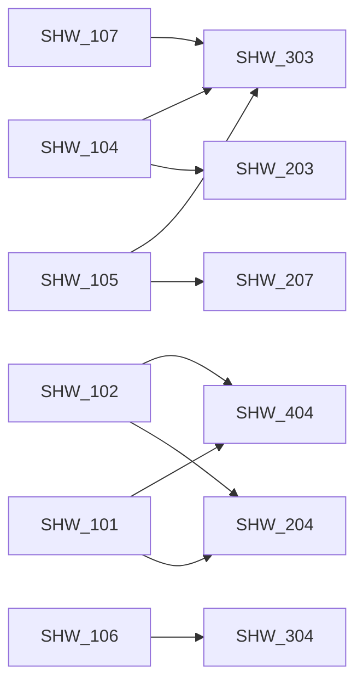

# Ticket board

_Generated by `scripts/tickets.py index`. Do not edit by hand._

## Todo (27)

| ID | Type | Pri | Size | Title | Depends on |
|---|---|---|---|---|---|
| [SHW-101](SHW-101-bulk-discount-missing-at-ten.md) | bug | high | XS | Customers buying exactly 10 copies don't get the bulk discount |  |
| [SHW-102](SHW-102-discount-rounding-off-by-a-cent.md) | bug | medium | XS | Discounted line totals are sometimes one cent too low |  |
| [SHW-103](SHW-103-unknown-book-returns-200.md) | bug | medium | XS | GET /books/{id} returns 200 for books that don't exist |  |
| [SHW-104](SHW-104-cancelled-orders-dont-restock.md) | bug | high | S | Cancelling an order doesn't put the books back on the shelf |  |
| [SHW-105](SHW-105-failed-order-leaks-stock.md) | bug | high | S | A rejected multi-book order still removes stock for the books it did reserve |  |
| [SHW-106](SHW-106-concurrent-orders-oversell.md) | bug | critical | L | Popular books are occasionally oversold when many orders arrive at once |  |
| [SHW-107](SHW-107-zero-or-negative-quantity.md) | bug | high | S | Orders with a zero or negative quantity cause 500s (and odd stock numbers) |  |
| [SHW-201](SHW-201-validate-book-creation.md) | feature | high | M | Validate input when creating a book |  |
| [SHW-202](SHW-202-search-filter-paginate-books.md) | feature | medium | M | Search, filter and paginate the book list |  |
| [SHW-203](SHW-203-order-status-state-machine.md) | feature | high | M | Enforce valid order status transitions | SHW-104 |
| [SHW-204](SHW-204-discount-codes.md) | feature | medium | L | Support discount codes on orders | SHW-101, SHW-102 |
| [SHW-205](SHW-205-low-stock-report.md) | feature | low | S | Low-stock report endpoint |  |
| [SHW-206](SHW-206-customer-order-history.md) | feature | medium | M | List and filter orders (customer order history) |  |
| [SHW-207](SHW-207-idempotent-order-placement.md) | feature | medium | M | Make POST /orders idempotent with an Idempotency-Key header | SHW-105 |
| [SHW-301](SHW-301-inject-time-provider.md) | refactor | medium | S | Replace direct DateTime.Now/UtcNow calls with an injectable TimeProvider |  |
| [SHW-302](SHW-302-split-program-cs.md) | refactor | low | M | Split Program.cs into endpoint modules and a service-registration extension |  |
| [SHW-303](SHW-303-result-type-for-domain-errors.md) | refactor | low | L | Replace exceptions-as-control-flow in the domain with a Result type | SHW-104, SHW-105, SHW-107 |
| [SHW-304](SHW-304-sqlite-persistence-ef-core.md) | feature | medium | XL | Persist data to SQLite with EF Core | SHW-106 |
| [SHW-401](SHW-401-github-actions-ci.md) | chore | low | XS | Add a GitHub Actions CI workflow |  |
| [SHW-402](SHW-402-request-logging-correlation-id.md) | feature | low | S | Structured request logging with correlation IDs |  |
| [SHW-403](SHW-403-openapi-documentation.md) | chore | low | S | Publish an OpenAPI document with accurate response metadata |  |
| [SHW-404](SHW-404-pricing-and-order-invariant-tests.md) | test | medium | S | Add edge-case and invariant tests for pricing and orders | SHW-101, SHW-102 |
| [SHW-405](SHW-405-enable-analyzers-warnings-as-errors.md) | chore | low | S | Turn on .NET analyzers and treat warnings as errors |  |
| [SHW-501](SHW-501-api-key-auth-for-writes.md) | security | high | M | Require an API key for mutating catalog and fulfilment endpoints |  |
| [SHW-502](SHW-502-rate-limit-order-placement.md) | security | low | S | Rate limit POST /orders per client |  |
| [SHW-601](SHW-601-spike-multi-currency-pricing.md) | spike | low | S | Spike: design multi-currency pricing |  |
| [SHW-602](SHW-602-spike-codebase-review.md) | spike | medium | M | Spike: independent review of the codebase for defects and risks |  |

## In Progress (0)

_none_

## In Review (0)

_none_

## Blocked (0)

_none_

## Done (0)

_none_

## Dependency graph

